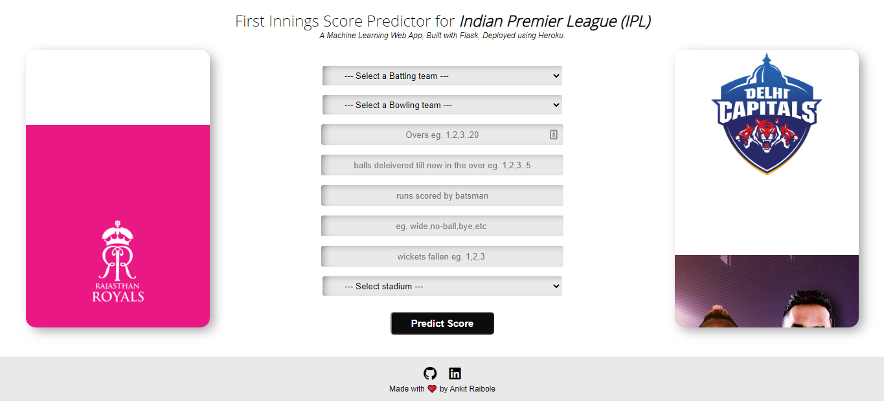
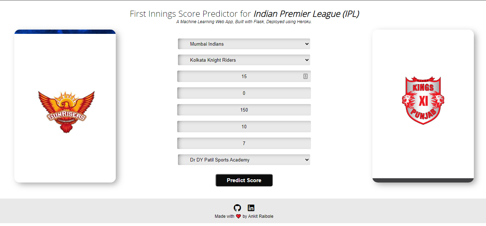
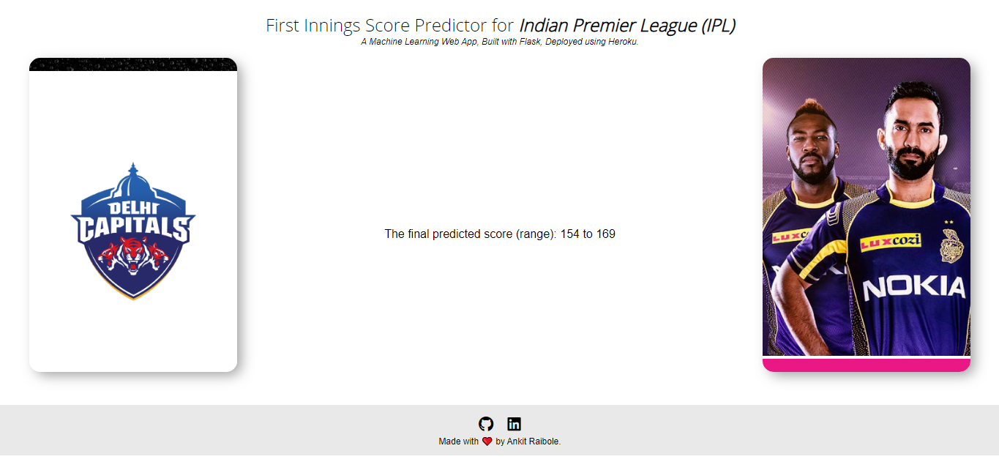

[](https://github.com/tterb/atomic-design-ui/blob/master/LICENSEs)

# Score Master

Score Master is a machine learning-powered T20 cricket score prediction application. A Ridge Regression model trained on IPL matches (2008–2019) predicts first-innings scores in real time.

## Recruiter Snapshot

- **Product:** ML-powered T20 cricket score prediction app using Ridge Regression trained on historical IPL data.
- **Core engineering value:** Fast inference on match state (teams, venue, overs, wickets) with real-time score range prediction.
- **Backend:** Flask 3.x, scikit-learn, Gunicorn, Pickle-based model serialization.
- **DevOps:** Docker containerized, Traefik TLS routing, GitHub Actions SSH deployment to VM.
- **Ownership signal:** End-to-end ML inference pipeline from model training to production REST API.

---

## Architecture

```
Browser (Jinja2 form)
    │
    │  POST /predict
    ▼
Flask + Gunicorn (:8000, behind Traefik)
    │
    │  Extract match features
    ▼
Ridge Regression Model (Pickle)
    │
    ▼
Score Range Prediction (predicted ± margin)
    │
    ▼
Browser (result.html)
```

## Tech Stack

- **Frontend:** Jinja2, HTML/CSS (Bootstrap template)
- **Backend:** Flask 3.x, Gunicorn (4 workers)
- **ML:** scikit-learn Ridge Regression, Pickle serialization
- **Data:** Pandas, NumPy, SciPy
- **Infrastructure:** Docker (Python 3.12 slim), Traefik, GitHub Actions
- **Deployment:** VM + Docker Compose (same pattern as other projects)

---

## Features

- Predicts final inning scores based on live match state
- Supports all 8 IPL teams and 30+ stadiums
- Real-time inference with instant result display
- Responsive web interface


# Demo

https://user-images.githubusercontent.com/46680697/150517395-f537a2de-8b57-49e4-821f-0f928678e5bb.mp4


## Screenshots







## Tech Stack

**Client:** Flask, Jinja2

**Server:** Ridge Regression model, Pickle module

**Languages** Python, HTML, CSS


## Installation & Local Development

```bash
python -m venv venv
source venv/bin/activate
pip install -r requirements.txt
export FLASK_ENV=development
flask run --debug
```

Open `http://127.0.0.1:5000`. Fill in match details (teams, venue, current state) to predict the final score.

---

## Production Deployment

This follows the same Docker Compose + GitHub Actions pattern as your other VM projects.

- Source code clones to `/opt/projects/score-master`
- Stack config (compose + env) lives in `/home/ubuntu/stacks/score-master`

### 1) VM setup (one-time)

```bash
mkdir -p /home/ubuntu/stacks/score-master
# Copy docker-compose.prod.yml into that folder
# Create .env.production with your domain
```

### 2) `.env.production` sample

```dotenv
APP_DOMAIN=score-master.tk
FLASK_ENV=production
SECRET_KEY=your-random-secret-key-here
DEBUG=false
```

### 3) GitHub Variables

- `VM_USER=ubuntu`
- `DEPLOY_PATH=/opt/projects/score-master`
- `COMPOSE_FILE=/home/ubuntu/stacks/score-master/docker-compose.prod.yml`
- `ENV_FILE=/home/ubuntu/stacks/score-master/.env.production`

### 4) GitHub Secrets

- `VM_HOST` → VM IP
- `SSH_PRIVATE_KEY` → deploy SSH private key
- `VM_HOST_KEY` → `ssh-keyscan -H <vm-ip>` output

### 5) Deploy

```bash
git push origin master
```

Traefik routes `score-master.tk` traffic to the Flask app with automatic HTTPS.

---

## Improvement Notes

Dependencies have been modernized (Flask 3.x, scikit-learn 1.3+, Python 3.12). For further improvements:
- Refactor team/venue mappings into YAML config instead of hardcoded code
- Add input validation and error handling
- Add `/health` endpoint for container liveness checks
- Cache model in memory at startup
- Add logging and metrics


## Authors

- [@iota-008](https://www.github.com/iota-008)
